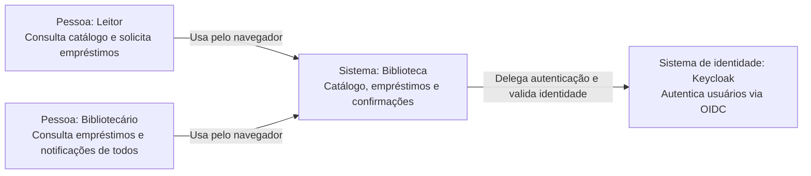
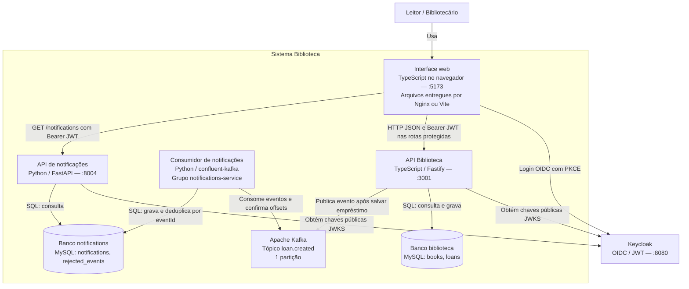
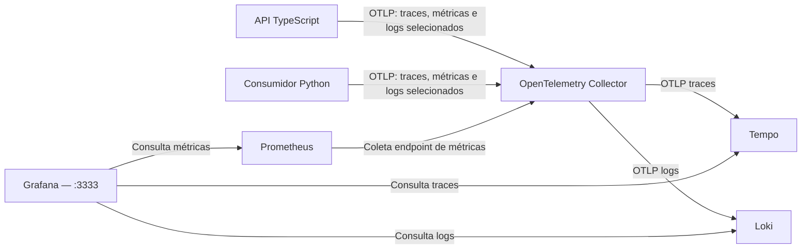
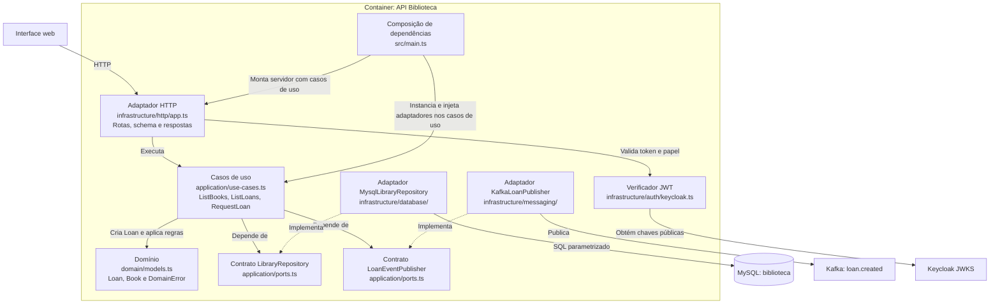
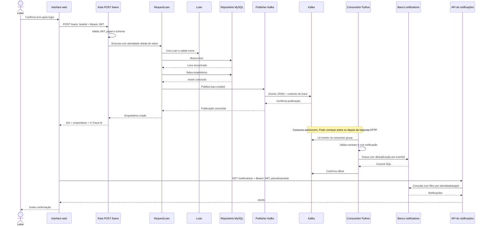

# Arquitetura — Biblioteca

Diagramas C4 em Mermaid, renderizados pelo GitHub. Representam o código atual. As setas indicam quem inicia a interação e seus rótulos descrevem o protocolo ou responsabilidade.

## C4 nível 1 — Contexto

O sistema permite consultar livros, registrar empréstimos e acompanhar confirmações. Notificação significa um registro exibido na interface; não há envio de e-mail ou SMS.

Para explicar: comece pelas pessoas, objetivo do sistema e identidade. Keycloak aparece como sistema de apoio fora do limite funcional da Biblioteca, embora seja executado no mesmo Compose.

## C4 nível 2 — Containers

No C4, container é uma aplicação ou armazenamento executável; não significa obrigatoriamente um container Docker. O JavaScript da interface executa no navegador. Nginx ou Vite entrega seus arquivos.

- Os dois bancos estão na mesma instância MySQL, mas possuem usuários e permissões separados. A API Biblioteca não consulta as tabelas de notificações.
- O navegador consulta diretamente as duas APIs; não existe BFF.
- A resposta HTTP 201 aguarda a publicação confirmada pelo Kafka, mas não aguarda o Python. A interface consulta periodicamente a confirmação.
- JWT é validado localmente pelas APIs com as chaves do Keycloak. Elas não enviam cada token ao Keycloak para introspecção.

### Apoio operacional ao nível 2

Os serviços de inicialização do Compose preparam bancos, tópico e permissões de volumes. Não aparecem no diagrama funcional para manter o foco nas aplicações em execução. Kafka UI também é uma ferramenta auxiliar.

## C4 nível 3 — Componentes da API Biblioteca

Este nível amplia apenas a API TypeScript. As dependências dos casos de uso apontam para contratos; as implementações de infraestrutura realizam esses contratos.

O domínio e os casos de uso não importam Fastify, mysql2 ou KafkaJS. `main.ts` escolhe as implementações concretas. Os testes substituem a persistência e a publicação por objetos em memória. O módulo `infrastructure/telemetry.ts` instrumenta os adaptadores, sem introduzir OpenTelemetry no domínio.

No Python, `main.py` recebe eventos e chama `RegisterNotification`; `http_api.py` recebe consultas e chama `ListNotifications`. Ambos usam contratos de `application.py`, implementados por `MysqlNotificationRepository` em `database.py`. `domain.py` valida o contrato recebido e cria a notificação.

## Percurso para demonstrar na gravação

Este diagrama de sequência complementa o C4: mostra a execução de um pedido, em vez da estrutura estática.

Para a gravação, acompanhe o POST no Network, abra a rota e `RequestLoan`, mostre os adaptadores e o consumidor e termine no trace do Grafana. O trace correlaciona API, publicação e consumidor; não inclui todas as etapas do navegador, login ou consulta periódica.

Limite relevante: insert do empréstimo e publicação Kafka são operações separadas, sem outbox. Uma falha de publicação pode deixar o empréstimo salvo e retornar 503 com seu ID. A deduplicação do consumidor evita repetir a notificação ao reprocessar o mesmo evento; não torna o POST idempotente.
