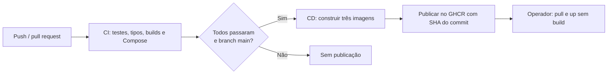

# CI/CD — da alteração à entrega

O workflow [ci.yml](../.github/workflows/ci.yml) executa integração contínua e entrega contínua. A implantação na máquina é iniciada por comando; não há servidor remoto, GitOps ou implantação automática em produção.



## O que é entregue

Três imagens Linux amd64: `ghcr.io/raforget/biblioteca/api`, `ghcr.io/raforget/biblioteca/notifications` e `ghcr.io/raforget/biblioteca/web`. A imagem Python atende tanto o consumidor quanto a API de consulta. A imagem da API também executa a preparação do banco.

As tags são o SHA completo do commit, permitindo escolher uma versão específica em vez de uma tag móvel `latest`. Use apenas tags de execuções cujo job CD terminou com sucesso: a publicação das três imagens é sequencial, sem transação entre os pushes. Os arquivos Compose e configurações montadas continuam vindo do repositório no mesmo commit.

O job de publicação espera os quatro jobs de CI. Só ele tem `packages: write`; usa o `GITHUB_TOKEN` temporário, sem cadastrar um token pessoal no workflow. Pull requests não publicam imagens. As imagens de terceiros continuam vindo de seus registries originais.

## Primeira publicação

Em **Actions → CI/CD Biblioteca**, acompanhe o job **CD — Publicar imagens no GHCR**. Ao concluir, o resumo mostra as três referências e o SHA da entrega. Os pacotes ficam vinculados ao repositório pelo label `org.opencontainers.image.source`.

Pacotes novos do GHCR podem começar privados, mesmo com repositório público. Para facilitar a execução pelo professor sem login no registry, o proprietário pode abrir cada pacote em **Packages → Package settings → Change visibility → Public**. Isso torna as imagens públicas; é uma decisão de visibilidade separada. Para mantê-las privadas, o usuário que fará o pull precisa de acesso ao pacote e autenticação no GHCR com token de leitura de pacotes. Não coloque tokens no README, `.env` versionado ou vídeo.

## Executar uma entrega no PowerShell

Tenha Docker Desktop aberto, este repositório clonado e `.env` criado a partir de `.env.example`. Encerre a sessão Watch e qualquer frontend local antes de trocar o modo. Na pasta do projeto, substitua o exemplo pelo SHA completo de uma entrega concluída:

```powershell
$entrega = 'SHA_COMPLETO_DO_COMMIT_PUBLICADO'
git fetch origin
git checkout $entrega
$env:IMAGE_TAG = $entrega
docker compose -f compose.yaml -f compose.release.yaml pull
docker compose -f compose.yaml -f compose.release.yaml up -d --no-build --wait
docker compose -f compose.yaml -f compose.release.yaml ps
```

Abra http://localhost:5173. Faça login e registre um empréstimo; confirme a notificação. O pipeline valida o código e a construção, mas não substitui esse teste integrado autenticado.

Para voltar a uma entrega anterior, escolha seu SHA e repita os comandos. Os volumes são preservados. Isso não reverte migrações ou dados; uma versão antiga precisa continuar compatível com o schema existente. Não use `down -v` para atualizar versões.

Para voltar ao desenvolvimento, retorne à branch e ao Compose de Watch:

```powershell
git switch main
Remove-Item Env:IMAGE_TAG -ErrorAction SilentlyContinue
docker compose -f compose.yaml -f compose.dev.yaml up --build --watch
```

## Demonstração no vídeo

1. Mostre uma alteração, commit e push na `main`.
2. Abra Actions e explique os quatro jobs de CI.
3. Mostre que o CD só começa após todos passarem.
4. Abra os pacotes e a tag correspondente ao commit.
5. Mostre `pull` e `up --no-build`: a máquina recebe a entrega pronta.
6. Abra a interface e valide um empréstimo.

Referências: [publicação de imagens pelo GitHub Actions](https://docs.github.com/en/actions/tutorials/publish-packages/publish-docker-images) e [acesso ao Container Registry](https://docs.github.com/en/packages/working-with-a-github-packages-registry/working-with-the-container-registry).
